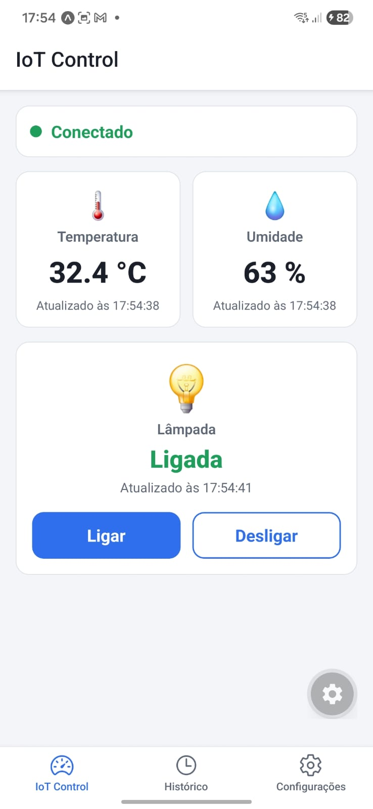
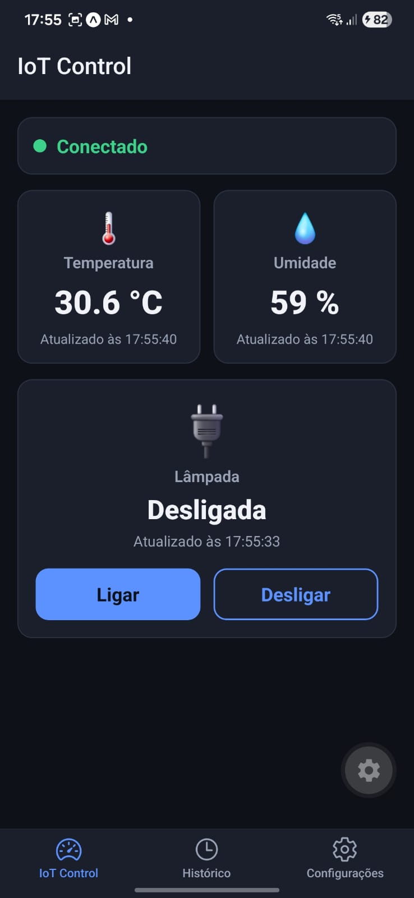
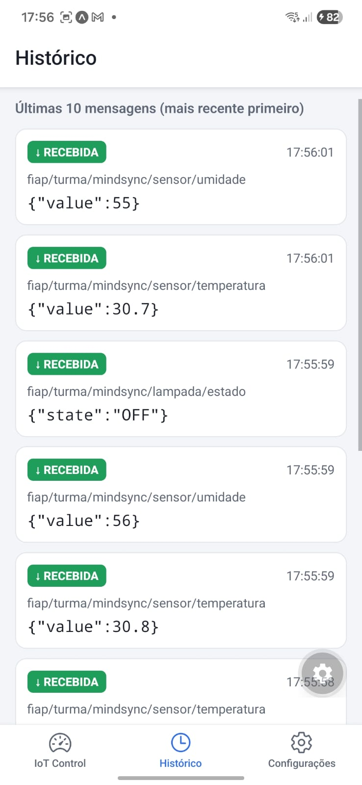
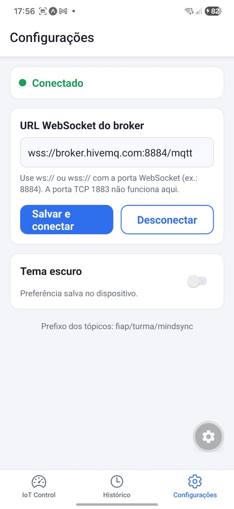

# IoT Control - Painel de Monitoramento e Controle IoT com MQTT

Aplicativo mobile em **React Native + Expo + TypeScript** que monitora um ambiente inteligente simulado (temperatura, umidade e lâmpada virtual) usando o protocolo **MQTT** (modelo publish/subscribe) através de um broker acessível por **WebSocket**.

## Tecnologias e versões

| Tecnologia | Versão |
|---|---|
| Expo SDK | ~57.0 |
| React Native | 0.86.3 |
| React | 19.2.3 |
| TypeScript | ~6.0 |
| paho-mqtt (cliente MQTT sobre WebSocket) | ^1.1.0 |
| @react-native-async-storage/async-storage | 2.2.0 |
| @react-navigation/native + bottom-tabs | ^7 |
| mqtt (somente o simulador, Node.js) | ^5 |

Requisitos: **Node.js 20+** (testado com 22) e o app **Expo Go** no celular (ou emulador Android/iOS).

## Instalação e execução

```bash
npm install
npx expo start
```

Escaneie o QR Code com o Expo Go (Android) ou com a câmera (iOS). Atalhos no terminal: `a` (Android), `i` (iOS), `w` (Web).
Se o celular não alcançar o computador pela rede local, use `npx expo start --tunnel`.

Verificação de tipos: `npm run typecheck`.

## Broker MQTT (WebSocket)

Broker público de testes do HiveMQ (usado por padrão):

| Protocolo | URL | Observação |
|---|---|---|
| **WSS (padrão)** | `wss://broker.hivemq.com:8884/mqtt` | Recomendado (TLS) |
| WS | `ws://broker.hivemq.com:8000/mqtt` | Sem TLS |

> A porta **1883** é MQTT sobre TCP e **não funciona** no app (que precisa de WebSocket). Ela é usada apenas pelo simulador em Node.js, que fala TCP.

A URL pode ser alterada na tela **Configurações** e fica salva no AsyncStorage. Nenhuma senha ou credencial é usada/versionada.

## Tópicos MQTT

Prefixo exclusivo do grupo, definido em `src/config.ts` (`TOPIC_PREFIX`): **`fiap/turma/mindsync`**

| Tópico | Direção no app | Payload de exemplo |
|---|---|---|
| `fiap/turma/mindsync/sensor/temperatura` | Subscribe | `{"value":24.5}` |
| `fiap/turma/mindsync/sensor/umidade` | Subscribe | `{"value":58}` |
| `fiap/turma/mindsync/lampada/comando` | Publish | `{"action":"ON"}` ou `{"action":"OFF"}` |
| `fiap/turma/mindsync/lampada/estado` | Subscribe | `{"state":"ON"}` ou `{"state":"OFF"}` |

Validações aplicadas às mensagens recebidas: JSON válido; `value` numérico finito (temperatura entre −60 e 150; umidade entre 0 e 100); `state` apenas `ON`/`OFF`. Mensagens inválidas **não** alteram a tela e aparecem no histórico marcadas como “⚠ inválida”.

## Simulador do dispositivo

Incluído em `scripts/simulator.mjs`. Em **outro terminal**:

```bash
npm run simulator
```

O simulador:
- publica temperatura e umidade a cada 3 s;
- escuta `.../lampada/comando` e, ao receber `ON`/`OFF`, publica o novo estado em `.../lampada/estado` (com `retain`, para o app mostrar o estado assim que conectar).

Opções (variáveis de ambiente):

```bash
# Linux / macOS
TOPIC_PREFIX=fiap/turma/mindsync npm run simulator

# Windows PowerShell
$env:TOPIC_PREFIX="fiap/turma/mindsync"; npm run simulator
```

Comandos digitáveis no terminal do simulador: `bad` (publica payload inválido na temperatura para testar a validação), `state` (republica o estado da lâmpada) e `quit`.

### Alternativa sem o script: cliente web do HiveMQ

Acesse <https://www.hivemq.com/demos/websocket-client/>, conecte (Host `broker.hivemq.com`, Port `8884`, TLS ativado) e:
1. **Subscribe** em `fiap/turma/mindsync/lampada/comando`.
2. **Publish** em `.../sensor/temperatura` com `{"value":24.5}` e em `.../sensor/umidade` com `{"value":58}`.
3. Ao tocar em Ligar no app, chega `{"action":"ON"}`; publique `{"state":"ON"}` em `.../lampada/estado`.

## Roteiro de verificação (ciclo completo)

1. `npm run simulator` e `npx expo start`; abra o app → status **Conectado**.
2. Temperatura e umidade atualizam sozinhas, com horário da leitura.
3. Toque em **Ligar** → botão mostra carregando → simulador recebe `{"action":"ON"}` e publica `{"state":"ON"}` → app exibe **Ligada**.
4. Repita com **Desligar** → **Desligada**.
5. Aba **Histórico**: últimas 10 mensagens (enviadas ↑ / recebidas ↓).
6. Em **Configurações**: alterne o tema, feche e reabra o app (tema e URL permanecem).
7. Teste de erro: desligue o Wi-Fi ou use uma URL errada → status **Erro de conexão**, com reconexão automática (1 s, 2 s, 4 s… até 15 s) e botão **Reconectar agora**. Desconectado, tocar em Ligar/Desligar mostra aviso (nada é enviado em silêncio).

## Funcionalidades

- **Conexão**: configurar URL WebSocket, conectar/desconectar, estados *conectando / conectado / desconectado / erro*, mensagens de erro claras, reconexão automática com backoff exponencial e ação manual de reconectar.
- **Tempo real**: assinatura dos tópicos de temperatura, umidade e estado da lâmpada; a UI atualiza sem botão de atualização, mostrando último valor e horário.
- **Comandos**: Ligar/Desligar publicam no tópico de comando. O estado exibido da lâmpada vem **somente** da mensagem de estado recebida; se o dispositivo não confirmar em 6 s, o app avisa.
- **Histórico**: 10 mensagens mais recentes (tópico, payload, horário, direção).
- **Preferências**: URL do broker e tema (Light/Dark) salvos com AsyncStorage e restaurados ao abrir.
- **Boas práticas**: serviço MQTT isolado (`src/services/mqttService.ts`), listeners removidos no `useEffect` cleanup, callbacks de conexões antigas ignorados (sem eventos duplicados), TypeScript estrito sem `any`.

## Estrutura

```
App.tsx
scripts/simulator.mjs
src/
  config.ts                   # prefixo, tópicos e URL padrão
  components/                 # SensorCard, ConnectionStatus, MessageItem, LampControl, AppButton
  context/                    # SettingsContext (tema/URL) e MqttContext (estado MQTT)
  navigation/AppNavigator.tsx # abas Dashboard / Histórico / Configurações
  screens/                    # DashboardScreen, HistoryScreen, SettingsScreen
  services/                   # mqttService.ts, storageService.ts
  themes/colors.ts            # paletas Light e Dark
  types/                      # mqtt.ts e declarações do paho-mqtt
  utils/                      # validators.ts, format.ts
```

## Prints das telas

<table>
  <tr>
    <th align="center">Dashboard (Light)</th>
    <th align="center">Dashboard (Dark)</th>
    <th align="center">Histórico</th>
    <th align="center">Configurações</th>
  </tr>
  <tr>
    <td align="center"></td>
    <td align="center"></td>
    <td align="center"></td>
    <td align="center"></td>
  </tr>
</table>

## Limitações e observações

- O broker público do HiveMQ é compartilhado e sem autenticação: use sempre um prefixo de tópicos exclusivo do grupo e não envie dados sensíveis.
- O app usa QoS 0 e sessão limpa; ao reconectar, ele reassina os tópicos automaticamente.
- Leituras só aparecem enquanto o simulador publica; o estado da lâmpada aparece imediatamente por causa da mensagem *retained* do simulador.
- Em redes que bloqueiam WebSocket/portas não padrão (ex.: 8884), troque a URL ou use outra rede/hotspot.
- No Android, `ws://` (sem TLS) pode ser bloqueado em builds de produção; prefira `wss://`.

## Integrantes

| Nome completo | RM |
|---|---|
| Heloísa Fleury Jardim | RM556378 |
| Juan Fuentes Rufino | RM557673 |
| Paulo Henrique Monteiro Golovanevsky | RM555300 |
| Pedro Henrique Silva Batista | RM558137 |
| Rickelmyn de Souza Ruescas | RM556055 |